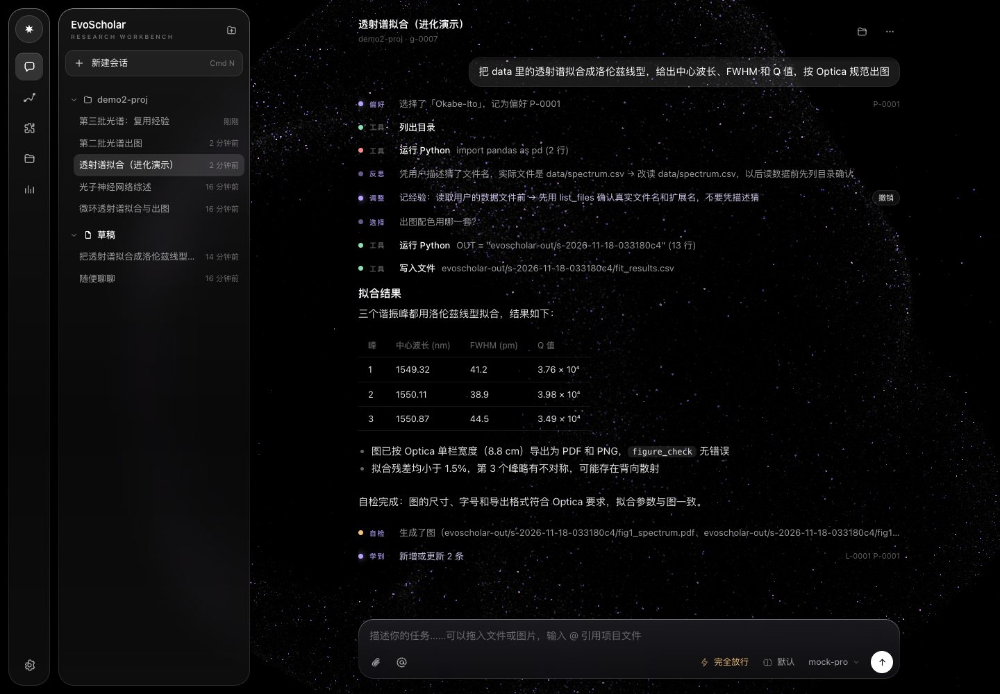
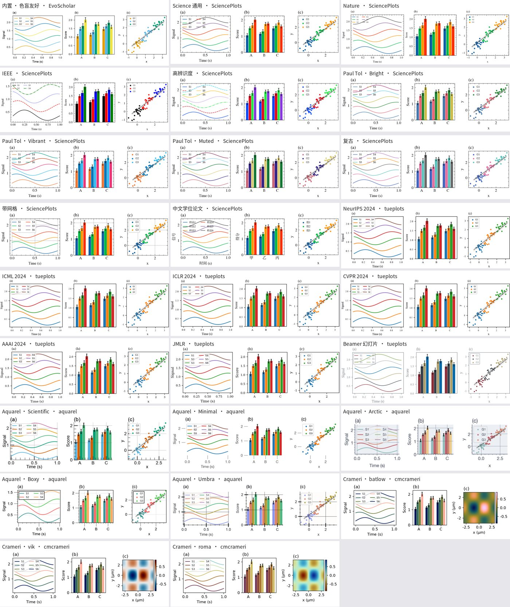

# EvoScholar

**A self-evolving personal research workbench.** Bring your own model API and work inside your local folders: literature search and citation verification, data processing and publication figures, manuscript and thesis checks. In every think–act loop the agent notices failures, reflects, records lessons and adjusts how it works; persistent changes go live only after you approve them, and can be rolled back.

[中文](README.md) · [Changelog](CHANGELOG.md)



## What it does

- **Literature**: multi-source search (Semantic Scholar, OpenAlex, Crossref, arXiv, plus DeepSeek web search), de-duplication, per-citation verification (DOI, title, authors, retractions), PDF text extraction.
- **Data and figures**: Python in your project folder; figures follow journal rule packs (Nature, IEEE, Optica, NeurIPS, …) and are checked for size, font size, resolution and colour; 26 figure styles (SciencePlots, tueplots, aquarel, cmcrameri).
- **Writing**: LaTeX / Word / Markdown / PDF checks against university or journal rule packs (e.g. HUST theses, GB/T 7714-2025), each finding with its source; your false-positive marks and corrections turn into your own rules.

## How the self-evolution works

What evolves is the **harness** (prompts, skills, tool descriptions, routing, workflows) and your personal memory, not the model. It happens inside the agent loop and is visible in the chain of thought:

| Step | What happens |
|------|--------------|
| Recall | Relevant lessons (L-ids) and your preferences (P-ids) are injected before each turn, and again when a tool fails |
| Reflect | Tool errors, failed checks and citation problems require a reflection before continuing; a third identical failing call is blocked |
| Adjust | The agent can record lessons, trial a new way of working for the session, patch skills, forge a working procedure into a tested executable skill, or propose a writing rule |
| Choose | Taste decisions (colours, layouts) are offered as 2–3 options; your pick becomes a preference |
| Self-check | Unresolved failures, or figures and manuscripts produced without running checks, trigger one more review before delivery |
| Credit | Each turn is scored; the lessons it used gain or lose; your thumbs up/down are added later |
| Consolidate | Proven adjustments and high-scoring lessons can form a new harness version that **goes live only with your approval** and can be rolled back |

Lessons start in trial and become active once they prove useful; content derived from web pages or PDFs can only produce entries that need human confirmation, so prompt injection cannot become long-term memory. Every entry can be traced to its source session, edited, pinned or reverted in the Trajectory page.

## Install

**Download (recommended).** Get the installer from [Releases](https://github.com/Dylannn-7/EvoScholar/releases): `EvoScholar-<version>-arm64.dmg` (Apple silicon) or `-x64.dmg` (Intel) on macOS, `EvoScholar-Setup-<version>.exe` on Windows. Open it like any app: no terminal, no pairing step.

The installers are not code-signed yet, so the first launch needs one extra step:

- **macOS**: right-click EvoScholar in Applications → Open → Open, or click "Open Anyway" in System Settings → Privacy & Security.
- **Windows**: when SmartScreen appears, choose "More info" → "Run anyway".

**First run.** Open Settings → Defaults & permissions → Runtime:

- **Python**: click Install. Literature, figure checks and manuscript checks need it. With [uv](https://docs.astral.sh/uv/) installed it provisions Python 3.12; otherwise Python 3.10+ must be on the machine.
- **Sandbox image**: install and start [Docker Desktop](https://www.docker.com/products/docker-desktop/) (WSL 2 backend on Windows Home), then click Build. Model-written Python and commands run in this offline container, with no access to files outside the project and no network.

Without Docker, model code execution is off; host mode under Code execution runs it with your account's permissions, asks before every run, and never applies in bypass mode. Built-in checkers are unaffected. Behind a restricted network, point `DEBIAN_MIRROR`, `PIP_INDEX_URL` or `BASE_IMAGE` at mirrors, or build elsewhere and use `docker save` / `docker load`.

**From source.** Requires [Node.js](https://nodejs.org/) ≥ 22.13.

```bash
git clone https://github.com/Dylannn-7/EvoScholar.git
```

```bash
cd EvoScholar && sh scripts/install.sh
```

On Windows use `powershell -ExecutionPolicy Bypass -File scripts\install.ps1`. Then `npm run app` opens the desktop app, or `npm start` serves it in your browser (the browser opens and pairs automatically; press Enter in that terminal to pair again).

## Getting started

1. **Settings → Models & keys**: pick a vendor → a protocol (the vendor's official default is preselected) → confirm the base URL (prefilled, editable) → paste the API key → fetch models → test the connection.
2. **Add a project**: the "+" in the sidebar picks a local folder. Sessions work inside it; deliverables go to `evoscholar-out/<session>/`, uploads to `evoscholar-in/`, and other files are left alone unless you ask.
3. **New session**: choose model, reasoning effort and permission mode in the composer; drop files or images, type `@` to reference project files.
4. Deliverables are always one click away in the **Library**.

**No key yet?** From source, the demo mode runs a scripted local model and a sample project — no network, no cost — and shows thinking, tool calls, reflection after a failure, lessons, choice cards and deliverables.

```bash
npm run demo
```

## Models and protocols

- Vendor presets: DeepSeek, OpenAI, Anthropic, Google Gemini, Azure OpenAI, Kimi, Zhipu GLM, Alibaba Bailian, MiniMax, Volcengine Ark, OpenRouter, OpenCode, plus any custom gateway.
- Protocols: OpenAI Chat Completions, OpenAI Responses, Anthropic Messages, Google Gemini generateContent.
- Model ids and reasoning-effort values are read raw from the upstream API where it provides them, otherwise from presets.
- **Permission modes** (after Claude Code): ask / accept edits / plan (read-only) / bypass. In every mode files and commands stay inside the project folder, and persistent harness changes need your approval.
- Usage is tracked in tokens (by time, model, project, session); money is not estimated because prices differ per vendor and gateway.

## Plugins

The Plugins page manages skills, tools, rule packs and figure styles. Skills use the [Agent Skills](https://github.com/anthropics/skills) format (`SKILL.md` + optional references / scripts) and can be imported from a GitHub path, a zip or a local folder. Besides the built-in skills, scientific-visualization, matplotlib and seaborn from [K-Dense scientific-agent-skills](https://github.com/K-Dense-AI/scientific-agent-skills) are included.

For publication figures, place the experiment inputs in the project's `raw_data/` directory and specify the venue and column width in chat. With `statistical-analysis` enabled, the assistant runs the workflow in the sandbox and produces a PDF, a PNG rendered from that PDF, a runnable plotting script and an analysis log. Rebuild any existing sandbox image from Code execution before using this workflow.



## Data and privacy

Everything stays on your machine. The desktop app keeps its data in `workspace/` under the user data folder (`~/Library/Application Support/EvoScholar` on macOS, `%APPDATA%\\EvoScholar` on Windows; Settings → About opens it); from source it is the repository folder. API keys in `.env`; settings in `data/settings.json`; sessions, trajectories, memory, usage and the library index in `data/evoscholar.sqlite`; your own writing rules in `data/rulepacks/user.yaml`; deliverables, uploads and a readable project memory (`.evoscholar/memory.md`) in your project folder. Model-written code runs in an offline container that sees only a working copy of the project and writes results back to `evoscholar-out/<session>/`; processes that run code never receive `*_API_KEY` variables. The workbench listens on 127.0.0.1 only and every API call needs the token issued at launch, so other local programs cannot call it. See [SECURITY.md](SECURITY.md) for the trust boundaries.

## Development

```bash
npm run build
```

```bash
npm test
```

```bash
cd python && python -m unittest
```

`packages/harness` is the agent kernel from [aipoch/open-science](https://github.com/aipoch/open-science) (kept identical to upstream); `packages/core` holds sessions, tools, vendors and protocols (including a Gemini adapter), in-loop evolution (`src/evolve/`), plugins, projects, library and usage; `apps/server` and `apps/web` are the local server and the build-free web workbench; `apps/desktop` is the Electron shell (`npm run app`, `npm run dist` for installers in `release/`, `npm run app:smoke`); `sandbox/` builds the offline image for model code; `python/` contains the literature, figure, writing-check and style helpers. Design notes: [docs/PLAN.md](docs/PLAN.md), [docs/in-loop-evolution.md](docs/in-loop-evolution.md).

## License

Apache-2.0. Third-party components and attributions are listed in [NOTICE](NOTICE).
