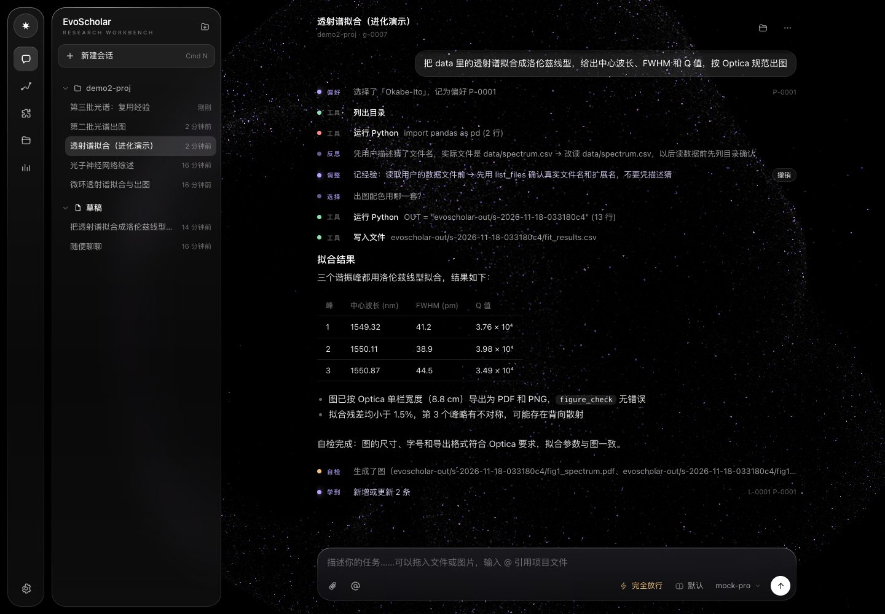
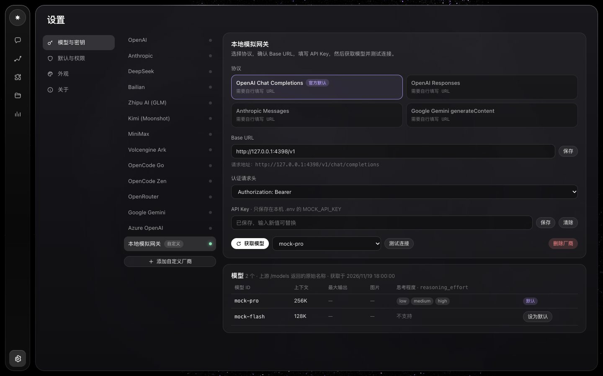
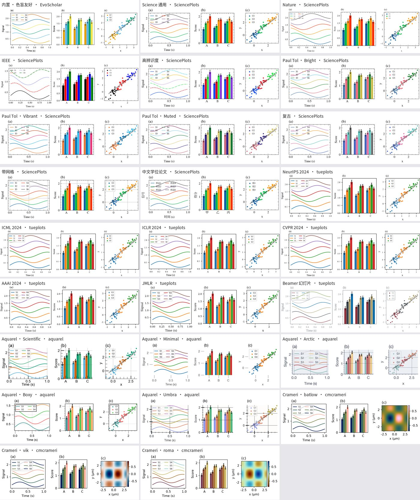

# EvoScholar

**会自我进化的个人科研工作台。** 接入你自己的模型 API，在本地文件夹里做文献检索与核验、数据处理与出图、论文和学位论文规范检查。智能体在每一轮思考—行动里观察失败、反思、记下经验、调整自己的工作方式；持久的改动经你批准才上线，随时可以回滚。

[English](README.en.md) · [更新记录](CHANGELOG.md)



## 能做什么

- **文献**：多源检索（Semantic Scholar、OpenAlex、Crossref、arXiv 等，加 DeepSeek 联网搜索），去重合并，引用逐条核验（DOI、题名、作者、撤稿状态），PDF 全文提取。
- **数据与出图**：在你的项目文件夹里运行 Python 处理数据；按期刊规则包（Nature、IEEE、Optica、NeurIPS 等）出图，出图后自动检查尺寸、字号、分辨率和配色；26 种出图风格（SciencePlots、tueplots、aquarel、cmcrameri）可选。
- **写作规范**：LaTeX / Word / Markdown / PDF 稿件按学校或期刊规则包检查（含华中科技大学学位论文、GB/T 7714-2025 等），每条问题附依据；你标记的误报和纠正会沉淀成自己的规则。

## 自进化是怎么发生的

进化的对象是 **harness**（提示词、技能、工具说明、路由、工作流）和你的个人记忆，而不是模型本身。全部发生在智能体的循环里，并显示在思维链中：

| 步骤 | 发生了什么 |
|------|------------|
| 回忆 | 每轮开始前，把相关的经验（L-编号）和你的偏好（P-编号）注入上下文；工具失败时再按失败内容检索一次 |
| 反思 | 工具报错、检查不通过、引用核验异常时，要求模型先反思再继续；同一个失败调用第三次会被拦截 |
| 调整 | 模型可以记经验、在本会话试用新的工作方式、给技能打补丁、把跑通的流程锻造成带测试的可执行技能、提出写作规则 |
| 选择 | 遇到配色、版式这类口味问题，给你 2–3 个方案点选，你的选择成为偏好 |
| 自检 | 有没解决的失败、或生成了图和稿件却没检查时，交付前自动再核对一轮 |
| 归因 | 每轮按结果打分，被用到的经验随之加分或扣分；你的好评、差评会补记进去 |
| 沉淀 | 表现好的调整和高分经验可以合成一个新的 harness 版本，**经你批准才上线**，可以回滚 |

经验先「试用」，被验证有效后才「生效」；来自网页或 PDF 的内容只能生成需要人工确认的条目，防止提示注入变成长期记忆。所有条目都能在「轨迹」页查看来源会话、编辑、置顶或撤销。

## 快速开始

需要 [Node.js](https://nodejs.org/) ≥ 22.13；文献、数据和出图功能还需要 Python 3.10+（有 [uv](https://docs.astral.sh/uv/) 更快）。

**macOS / Linux**

```bash
git clone https://github.com/Dylannn-7/EvoScholar.git
```

```bash
cd EvoScholar && sh scripts/install.sh
```

**Windows（PowerShell）**

```bash
git clone https://github.com/Dylannn-7/EvoScholar.git
```

```bash
cd EvoScholar; powershell -ExecutionPolicy Bypass -File scripts\install.ps1
```

然后启动并打开 http://127.0.0.1:4317 ：

```bash
npm start
```

1. **设置 → 模型与密钥**：选厂商 → 选协议（默认是厂商官方推荐的）→ 确认 Base URL（已预填，可改）→ 填 API Key → 获取模型 → 测试连接。
2. **添加项目**：左侧「+」选一个本地文件夹。会话在这个文件夹里工作，交付文件写到 `evoscholar-out/<会话>/`，上传的文件放在 `evoscholar-in/`，不会改动其他已有文件（除非你明确要求）。
3. **新建会话**：在输入框里选模型、思考程度和权限模式，可以拖入文件或图片、输入 `@` 引用项目文件。
4. 交付文件随时可以在 **资料空间** 找到，不用翻长会话。

**先不想填 Key？** 运行演示模式：本地脚本扮演模型，带一个示例项目，不联网、不花钱，可以完整看到思考、工具调用、失败后的反思、记经验、选项卡和交付文件。

```bash
npm run demo
```



## 模型与协议

- 预设厂商：DeepSeek、OpenAI、Anthropic、Google Gemini、Azure OpenAI、Kimi、智谱 GLM、阿里百炼、MiniMax、火山方舟、OpenRouter、OpenCode；也可以添加任意自定义网关。
- 协议：OpenAI Chat Completions、OpenAI Responses、Anthropic Messages、Google Gemini generateContent。
- 模型名和思考程度直接读取上游的原始取值；只有部分厂商在接口里提供思考程度，其余使用预设。
- **权限模式**（参照 Claude Code）：询问 / 自动接受编辑 / 计划（只读）/ 完全放行。无论哪种模式，文件和命令都只能在项目文件夹内，持久的 harness 改动都需要你批准。
- 工作台只统计 token 用量（按时间、模型、项目、会话），不统计费用：不同厂商和网关的价格各不相同，请以厂商账单为准。

## 插件

「插件」页管理技能、工具、规则包和出图风格。技能使用 [Agent Skills](https://github.com/anthropics/skills) 格式（`SKILL.md` + 可选的 references / scripts），可以从 GitHub 路径、zip 或本地文件夹导入。内置技能之外，已集成 [K-Dense scientific-agent-skills](https://github.com/K-Dense-AI/scientific-agent-skills) 的 scientific-visualization、matplotlib、seaborn。



## 数据与隐私

一切都在你的电脑上：

| 位置 | 内容 |
|------|------|
| `.env` | API Key（只写本机，不提交） |
| `data/settings.json` | 厂商设置、默认模型、默认权限 |
| `data/evoscholar.sqlite` | 会话、轨迹、经验与偏好、用量、资料空间索引 |
| `data/rulepacks/user.yaml` | 你自己沉淀的写作规则 |
| 项目文件夹的 `evoscholar-out/`、`evoscholar-in/`、`.evoscholar/memory.md` | 交付文件、上传文件、项目记忆的可读镜像 |

运行代码的子进程拿不到任何 `*_API_KEY` 环境变量；网页只监听 127.0.0.1，并拒绝非本机 Host 的请求。

## 开发

```bash
npm run build
```

```bash
npm test
```

```bash
cd python && python -m unittest
```

命令行：`npm run es -- chat | ask | providers | genome | budget`。目录结构：

| 目录 | 内容 |
|------|------|
| `packages/harness` | 智能体内核，来自 [aipoch/open-science](https://github.com/aipoch/open-science) 的 agent-harness，保持与上游一致 |
| `packages/core` | 会话、工具、厂商与协议（含 Gemini 适配器）、循环内自进化（`src/evolve/`）、插件、项目、资料空间、用量 |
| `apps/server` · `apps/web` | 本地 HTTP 服务与网页工作台（无构建步骤的 ES modules，three.js 粒子背景） |
| `python/` | 文献、出图、写作检查与出图风格的 Python 工具 |
| `genomes/` · `prompts/` · `skills/` · `rulepacks/` | harness 版本、提示词、技能、规则包 |

设计文档：[docs/PLAN.md](docs/PLAN.md)、[docs/in-loop-evolution.md](docs/in-loop-evolution.md)。

## 许可

Apache-2.0。第三方组件与署名见 [NOTICE](NOTICE)。
