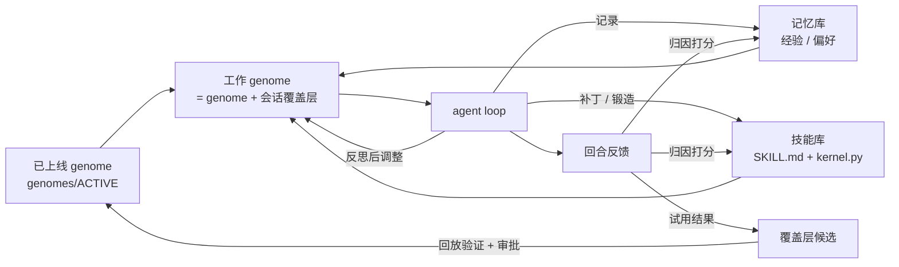
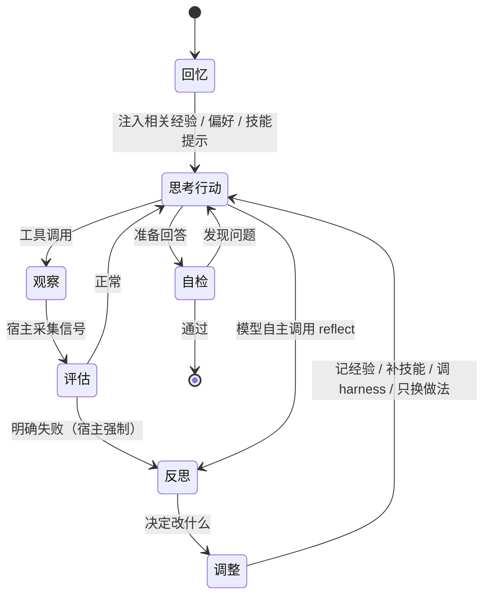

# 循环内自进化（In-Loop Self-Evolution）设计

状态：以下机制均已实现（截至 0.3.6）。**记忆与反思**：记忆库（经验 / 偏好，Beta 打分，试用 → 生效 → 淘汰，外部来源标为 untrusted）、回忆注入（回合开始 + 失败时上下文检索）、失败信号与强制反思、第三次相同失败的 guard、reflect / note_lesson / recall / tune_harness / offer_choices 五个工具、会话覆盖层（prompt.note、tool.note、skill.enable / disable，下一回合通过 configure 生效）、回答前自检（每回合最多一次）、回合评分与归因、迟到的好评 / 差评补记、「以后都……」直接记为置顶偏好、用户修改交付文件后的观察。代码在 `packages/core/src/evolve/`，测试在 `evolve.loop.test.ts`。
**技能与沉淀**：forge_skill / run_skill（静态检查 + 沙箱测试，试用 → 在另外两个会话复用成功后转正）、patch_skill（文档技能的新版本，经会话覆盖层试用）、propose_rule（写作规则提案进入用户规则包 `data/rulepacks/user.yaml`，试用规则以提示出现，用户采纳后生效）、沉淀（选中的会话调整和高分经验 → 一个 genome 候选，用户在「轨迹 → 版本」批准）。反思过的失败不再触发自检；「以后都 / 一律 / 每次都」才记为明确偏好。
**候选验证**：genome 候选可在本地做离线回放验证（`verifyCandidateOffline`），验证记录（运行编号、通过数与总数、范围）随候选显示在「轨迹 → 版本」；未经验证的候选需用户再次确认才能上线。可执行技能按项目与输入格式限定，按版本试用、审批转正并可回滚（见第 5 节）。尚未实现：workflow.* 与 route / param 算子。D9 的评委打分后来取消，回合评分只用用户信号与环境信号。

## 0. 已确定的决策

| # | 决策 | 用户选择 |
|---|------|----------|
| D1 | 进化对象 | **harness 层进化**（路由、工作流、工具描述、提示词、技能）放进 agent loop；**经验记忆**按用户的选择进化；**可执行技能**也纳入 |
| D2 | 谁触发反思 | 混合：出现明确失败信号时由宿主强制，其余情况由模型自主调用 `reflect` |
| D3 | 思维链里怎么体现 | 两条都要：结构化步骤卡片（可审计，用于归因）+ 模型推理文字里引用条目编号 |
| D4 | 反馈来源 | 四类都用：用户的显式反馈、环境自动信号、模型自评（自检 + 评委）、真实案例回放 |
| D5 | 自主权边界 | 经验和技能补丁自动生效，但可见、可撤销；系统提示和 genome 的持久修改需要审批 |
| D6 | 界面风格 | **网页去掉所有 emoji 和表情符号**（👍👎📎⚡👁⚠✓✗ 等），改用文字标签或单色线性图标；本方案的 UI 也不使用 emoji |
| D7 | 会话覆盖层 | harness 层的调整在**本会话内直接试用**，不需要审批；持久化到 genome 才需要审批 |
| D8 | 可执行技能转正 | 测试通过后在项目内试用。在另外两个会话执行成功后，请用户批准具体版本 |
| D9 | 评委打分 | 只在「有交付物，且没有用户信号和环境信号」时调用（约 ¥0.003 / 次） |
| D10 | 文件修改对比 | 允许：回合结束后比较用户修改过的产出文件，从中学习偏好，只在本地处理 |

固定评测集（`evals/`）保留，只作为可选的**回归护栏**，不再驱动进化。

---

## 1. 核心思路

现在的进化是「离线跑题 → 反思 → 出一个新 genome」。改成：**每个会话都持有一份可变的「工作 genome」**，智能体在思考—行动循环里观察信号、反思，然后当场修改它：

- 小改动（经验、偏好、技能补丁、新的可执行技能）立即生效，并在思维链里显示出来；
- 改 harness 结构的改动（路由、工作流、提示词、工具描述）先在本会话里**试用**；试用效果好，再沉淀成 genome 候选交给用户审批；
- 所有改动都和这一回合最终的「好 / 坏」挂钩，回合结束后按反馈给每个改动加分或扣分。好的留下，坏的撤销，形成闭环。



## 2. 进化的对象：什么时候生效、怎么持久化

| 对象 | 循环里的操作 | 本会话里何时生效 | 持久化 |
|------|--------------|------------------|--------|
| **经验**：「什么情况 → 怎么做」 | 自动提炼 / `note_lesson` | 下一步（注入上下文） | 自动，可撤销 |
| **偏好**：用户的口味和习惯 | 由用户的选择产生（§6） | 下一步 | 自动，可撤销 |
| **技能文档** `SKILL.md` | `patch_skill` | 下一步（`read_skill` 读到新版本；技能索引在下一回合更新） | 自动生成新版本文件，可撤销 |
| **可执行技能** `kernel.py` | `forge_skill` | 测试通过后可按版本在项目内试用 | 人工转正，可回滚到已批准的版本 |
| **模型路由与参数**：某阶段用哪个模型、推理强度 | `tune_harness` | 下一次模型请求 | 会话内试用；持久化需审批 |
| **工作流**：插入校验步骤、并行检索、子代理 | `tune_harness` | 下一回合 | 会话内试用；持久化需审批 |
| **工具描述 / 系统提示片段** | `tune_harness` | 下一回合 | 会话内试用；持久化需审批 |
| 预算、guards、工具授权、`evoscholar.config.json` | **禁止修改** | — | — |

**为什么分「下一步」和「下一回合」**：harness 的 `session.configure({ model, tools, instructions })` 只能在会话空闲（回合之间）调用，回合中途会抛出 busy 错误。所以：

- 回合中途能马上生效的，通过宿主自己的代码实现：
  - 模型路由：`meterModel` 包装层每次请求都读覆盖层，动态选择底层模型；
  - 上下文注入：`transformContext`；
  - 工具行为：工具对象的 `execute` 是宿主代码，可以读覆盖层。
- 改变工具集合、工具描述或系统提示的，在回合结束后通过 `session.configure()` 生效。
- 全部不修改 `packages/harness/src`。

## 3. 进化的 agent loop（每一步）



### 3.1 回忆（每次请求前，宿主执行，不调用模型）

`transformContext` 根据最近的用户消息、上一次工具调用、当前 stage 和项目检索记忆库与技能库，注入一个不写入存储的投影块：

```text
<经验 由 EvoScholar 检索，仅供参考；与用户本次要求冲突时以用户为准>
[L-0031] Semantic Scholar 返回 429 时 → 直接改用 arXiv + Crossref，重试不超过 1 次。（成功 3/3）
[P-0004] 用户偏好：出图用 Okabe-Ito 配色，坐标轴标签不加粗。（来自用户选择 2 次）
[K-0007] 可用技能 parse_lumerical_csv(path) → DataFrame，已复用 5 次。
</经验>
```

- 最多注入 6 条，合计不超过 1200 字；同一回合内内容不变就复用原文，以保持 DeepSeek 前缀缓存命中。
- 本步注入了哪些条目写进 `memory_uses`，供回合末归因。

### 3.2 评估与强制反思（宿主执行）

| 明确失败信号 | 判定 |
|--------------|------|
| 工具报错 | `tool.result.isError` |
| 进程失败 | `run_python` / `run_command` 退出码 ≠ 0 |
| 检查不通过 | `figure_check` / `manuscript_check` 有 error 级问题；`lit_verify` 出现 not_found / mismatch / retracted |
| 被拦截 | guard 拒绝、`checkCommand` 拦截、用户拒绝审批 |
| 原地打转 | 同一工具 + 近似参数连续 ≥ 2 次失败 |

出现信号时，在这条工具结果的投影后面追加：

```text
<反思要求>上一步失败：run_python 退出码 1，ModuleNotFoundError: pymupdf。
继续之前先调用 reflect：原因 → 下一步换什么做法 → 是否需要调整（经验 / 技能 / harness）。</反思要求>
```

- 同一失败调用连续出现第 3 次时，`guards` 直接拒绝执行，并提示必须先 `reflect`，防止死循环。
- 没有明确失败时（例如结果看起来不对、方向可能错了），由模型自己决定是否调用 `reflect`。系统提示里给出判断标准。

### 3.3 反思与调整（模型执行，通过工具落地）

| 工具 | 输入 | 效果 |
|------|------|------|
| `reflect` | `{ situation, cause, next_action, adjust?: none\|lesson\|skill\|harness }` | 写一张反思卡片；`adjust` 不是 none 时，要求接着调用对应工具 |
| `note_lesson` | `{ trigger, advice, scope, evidence }` | 新增或更新一条经验（相似条目会合并，不重复新增） |
| `patch_skill` | `{ skill, section, change, reason }` | 对 `SKILL.md` 做增量修改（增加 / 修改一条要点，不整篇重写），生成新版本文件 |
| `forge_skill` | `{ name, code, test, description, input_format }` | 保存带项目与输入格式作用域的试用版本（§5） |
| `tune_harness` | `{ op, target, value, reason }`，`op` 见 §4 | 修改会话覆盖层 |
| `recall` | `{ query, scope? }` | 主动检索记忆和技能 |

### 3.4 回答前自检（回合末）

满足下面任意一条时，宿主自动追加**一次**自检提示，然后再跑一轮：

- 本回合有没解决的失败信号；
- 有交付物（写了文件，或者 stage 是写作 / 出图），但没有运行对应的检查工具。

每个回合最多一次，计入同一个步数和预算。

## 4. harness 层的会话覆盖层

`tune_harness` 只能使用白名单里的算子，每个算子都映射到 genome 里一个已有的字段：

| op | 对应 genome 字段 | 示例 |
|----|------------------|------|
| `route` | `routing.rules` | 本会话「读图」阶段改用 vision 角色 |
| `param` | `routing.parameters` | 写作阶段推理强度改为 high |
| `workflow.insert` | `workflows` | 写文件后插入「独立重读交付物」的校验步骤 |
| `workflow.parallel` | `workflows` | 文献检索拆成两个并行子代理（上游 `createDelegationTool`） |
| `tool.note` | `tools.overrides.<t>.description` | 给 `lit_search` 的描述加一句「中文文献先用 site:cnki.net」 |
| `prompt.note` | `instructions.stages.<s>` 的附加段 | 给数据处理阶段追加一条规则 |
| `skill.enable` / `skill.disable` | `skills` | 本会话启用 `optics-spectra` |
| `budget.lower` | `budgets`（只能往下调） | 降低 maxSteps |

- 每次修改都先经过 `validateGenome()` 和受保护字段比对，任何试图改预算上限、guards 或授权的修改都会被拒绝并记录。
- 覆盖层的每一条都记下「引入它之前的回合结果」和「之后的回合结果」，作为试用证据。
- 会话结束或空闲时，表现好的覆盖层条目（之后的回合得分明显更高，或者用户给了好评）**打包成 genome 候选**，经过回放验证（§7.4）后进入「设置 → 进化」等待审批。
- 用户可以随时在对话里撤销覆盖层的某一条，撤销在下一步或下一回合生效。

## 5. 可执行技能（锻造）

借鉴 Voyager 的技能库：把会话里**跑通过**的处理流程沉淀成可复用的函数。

1. 文件处理流程跑通后，调用 `forge_skill` 封装 `run(**kwargs)` 和测试。静态检查通过后，在独立沙箱中用内联样例运行测试。通过的源码、测试与说明保存在 `skills/<name>/revisions/vN/`。
2. 宿主根据当前项目确定作用域。未关联项目的会话以工作目录划分作用域。`input_format` 记录文件路径参数、后缀和稳定的 UTF-8 表头。例如 `{"argument":"path","extension":".csv","header":["Wavelength,Signal","nm,linear a.u."]}`。执行前逐行核对实际文件的开头。不同项目或格式使用不同算子名称。
3. `run_skill` 接收 `name`、`version` 和 `args`。目录索引在下一回合更新，运行轨迹记录具体版本。新试用版和已生效版本可以同时存在。
4. 试用版在锻造会话之外的两个不同会话执行成功后，工作台会请用户批准该版本在当前作用域生效。执行成功计入技术复用记录，科研结果由数据对照验收。
5. 更新代码时用 `forge_skill` 新建版本。在「插件 → 技能详情」可把生效指针切回一个已批准版本，试用版本可以继续验证。升级前已经生效的旧算子可继续使用，未绑定作用域的历史试用算子需要重新锻造。

## 6. 按用户的选择进化（偏好记忆）

偏好来自「用户实际选了什么」，而不只是 👍👎：

| 来源 | 记成什么 |
|------|----------|
| **选项卡**：智能体遇到口味类决定（配色、图的版式、引用格式、表述风格、检索范围），可以用 `offer_choices` 给出 2–3 个方案，用户点选 | 一条偏好，附带被选中和被放弃的方案 |
| **用户修改了智能体产出的文件**：回合结束后对比智能体写入的版本和用户后来保存的版本 | 修改差异由回合复盘归纳成偏好（例如「用户把 Fig. 改成 图」） |
| **用户纠正**：「不对，我要的是……」 | 偏好或经验，取决于纠正的内容 |
| **拒绝审批、误报标记** | 负向偏好（例如「这类命令不要直接跑」「公知缩写不报」） |
| **重复出现的显式要求**：同一要求在不同会话里说过 ≥ 2 次 | 自动变成偏好，并提示用户「已记住」 |

- 偏好有作用域：全局 / 某个项目 / 某种 stage。与本次用户指令冲突时，以本次指令为准。
- 用户在对话里说「以后都这样」，直接写入偏好并置顶。

## 7. 反馈闭环

### 7.1 回合评分

每个回合结束后合成一个分数 `r ∈ [0,1]` 和置信度。用户信号优先，没有用户信号时依次往下看：

| 层级 | 信号 | 权重 |
|------|------|------|
| 1 用户显式 | 好评 / 差评、评分、纠正、误报标记、选项选择、修改了产出、拒绝审批 | 1.0（迟到的也能补记） |
| 2 环境自动 | 回合内的失败信号是否都已解决；检查工具最终结果；`lit_verify` 全部 verified；回合是否因预算 / 步数 / 超时结束 | 0.6 |
| 3 模型自评 | 回答前自检的结论；有交付物且没有更高层信号时，由评委角色按任务要求打分（fast 模型，约 ¥0.003 / 次） | 0.3 |
| 4 回放 | 不用于单个回合，而是在沉淀阶段验证候选（§7.4） | — |

### 7.2 归因

- 本回合被注入过的条目算「在场」，在 `reflect` 或推理里被引用了编号的算「被采用」。被采用的条目按 `r` 更新得分，权重加倍；只在场的条目权重减半。
- 一次失败明显和某条目无关（失败的工具或 stage 不在它的作用域里）时，不扣它的分。
- 打分用 Beta 后验均值：`score = (wins + 1) / (wins + losses + 2)`，排序时按最近使用时间衰减。

### 7.3 状态与淘汰

- 经验、偏好、技能有统一的状态：`trial → active → retired`，用户可以 `pinned`（置顶）。
- 用户直接给出的（纠正、选择、「以后都这样」）直接进入 `active`。
- 来自网页、PDF 等外部内容的条目标记为 `untrusted`，只能是 `trial`，必须经过用户确认或回合成功验证后才转正，防止**提示注入**变成长期记忆。
- `uses ≥ 5` 且 `score < 0.35`，或者 30 天没用到，就转为 `retired`。

### 7.4 沉淀与回放验证

- **回放集**：自动收集用户会话里「先失败、后修好」的回合，生成用例。输入是第一次提问和当时的文件快照；判定条件取成功那次的可检查特征，比如产物存在、检查工具没有 error、引用全部 verified。存放在 `data/replay/`，不公开。
- **沉淀**：空闲时把高分的经验簇改写成 genome 候选（工具描述、阶段提示、技能补丁），会话覆盖层的候选也走这一步。
- **验证**：候选在回放集上不比当前 genome 差；本地有 `evals/` 时，再跑一遍做回归护栏。然后进入审批。界面显示来源条目和证据会话。
- 回放和验证的费用计入 `evolution` 预算，每轮 ≤ ¥2，只在非高峰时段运行。

## 8. 思维链里怎么体现

**结构化卡片（主通道）**：SSE 新增 `evolve` 事件：

```json
{"type":"evolve","kind":"recall|reflect|adjust|self-check|credit","refs":["L-0031"],"text":"…"}
```

对话区沿用现在工具调用的行样式（状态圆点 + 名称 + 摘要，可以展开），**不用 emoji**，只用文字标签：

```text
· 回忆      3 条经验 · 1 条偏好                                  展开
· 反思      pymupdf 未安装 → 改用 pdf_text 工具                  展开
· 调整      经验 L-0045（试用）                         保留  撤销
· 调整      本会话：写文件后插入校验步骤                       撤销
· 自检      对照 4 项要求，全部满足
```

- 标签用小号大写字距、灰色文字，强调色只用于「调整」一类会改变后续行为的条目。
- 回合末卡片「本回合学到」：列出新增或更新的条目，以及得分变化。

**推理文字（辅助通道）**：系统提示要求模型在推理里按「计划 → 观察 → 反思 → 下一步」组织，用到经验时写出编号（例如「按 L-0031 直接换源」）。这条通道只用来增强可读性和统计「被采用」，不作为强制要求。

**粒子状态**：新增 `reflecting`（短暂收缩再重组）。

## 9. 安全边界

- 受保护内容不变：预算上限、guards、授权策略、`evoscholar.config.json`、评测集和回放集的判定条件。所有写入工具都会校验，命中「关闭检查 / 提高上限 / 跳过审批」这类内容时拒绝并记录。
- 外部内容只能产生 `untrusted` 条目（§7.3）。
- 可执行技能有沙箱、静态检查、测试和试用期（§5）。
- 一切都可见、可撤销：每个条目都能查到证据会话；记忆库按天快照；技能和提示词都是新版本文件，不覆盖旧文件；genome 回滚沿用现有功能。
- 成本：回忆和评估不调用模型；回合复盘和评委只在需要时调用 fast 模型，每回合最多一次，平均目标 ≤ ¥0.01 / 回合。

## 10. 存储

| 表 / 目录 | 内容 |
|-----------|------|
| `memory`（新表） | 经验和偏好：id、kind（lesson / preference）、scope、trigger、content、source、evidence、status、trust、uses、wins、losses、时间戳、genome_id |
| `memory_uses` | 条目 × 回合 × 步：在场 / 被采用、回合评分 |
| `skill_versions` | 技能名、版本、类型（doc / kernel）、状态、测试结果、uses、wins、losses |
| `overlays` | 会话覆盖层条目：会话、op、target、value、引入前后的回合评分、状态 |
| `turn_scores` | 回合评分：各层信号、合成分数、置信度 |
| `data/memory/memory.md` | 用户可读、可编辑的镜像 |
| `data/replay/` | 回放用例 |
| `events` 表 `host.evolve.*` | 全部变动的审计记录 |

## 11. 和现有代码的关系

| 现有 | 处理 |
|------|------|
| `evolution/evolve.ts` | 保留，作为「沉淀验证」的执行器；输入从「评测失败」扩展为「经验簇 / 覆盖层」 |
| `evolution/reflect.ts`、`mutate.ts` | 抽出轨迹精简和变异逻辑，供回合复盘和沉淀复用 |
| `workflow.ts`（未提交的进化 v2） | 工作流算子直接作为 `tune_harness` 的 `workflow.*` 实现 |
| `prompts/system@v5.md` 的「经验手册」 | 迁移成 3 条置顶的全局经验；系统提示 v6 改成说明经验注入块和反思规则 |
| `check_feedback`、`feedback` 表 | 作为第一层信号来源 |
| Web 界面 | 去掉所有 emoji（`app.js`、`ui/views.js` 里的 👍👎📎⚡👁⚠✓✗ 等）；新增 `evolve` 卡片和「设置 → 记忆与技能」标签 |

## 12. 实施方案

### 12.1 新增模块（全部在 `packages/core`，不改 `packages/harness/src`）

```
packages/core/src/evolve-loop/
  memory.ts        MemoryStore：经验 / 偏好的增删改查、合并去重、Beta 打分、状态转换、快照、memory.md 镜像
  recall.ts        检索与注入（transformContext 的第一段）；关键词 + 字符 n-gram 打分 × score，带缓存
  signals.ts       从 onEvent / trace 提取失败信号，维护「未解决信号」集合与打转检测
  reflex.ts        强制反思投影（transformContext 的第二段）+ 第 3 次重复失败的 guard
  overlay.ts       会话覆盖层：算子白名单、validateGenome、受保护字段比对、生效时机（即时 / 回合间）
  router.ts        动态路由的模型包装：每次请求读覆盖层，选择底层 AgentModel（复用 meterModel 计费）
  score.ts         回合评分：四层信号合成 r 和置信度；迟到反馈的补记
  credit.ts        归因：在场 / 被采用、作用域过滤、写 memory_uses、更新各条目和覆盖层的得分
  selfcheck.ts     回答前自检的触发判定与提示文本
  review.ts        回合复盘（fast 模型，只在有信号时）：提炼经验 / 偏好、文件修改对比、锻造提议
  judge.ts         评委打分（D9 的触发条件）
  forge.ts         可执行技能：静态检查、沙箱测试、版本、trial → active
  consolidate.ts   沉淀：经验簇 / 覆盖层 → genome 候选；回放集的收集与运行
  index.ts         installEvolveLoop(session 参数) → 组合成 transformContext、guards、onEvent、额外工具与回合钩子
packages/core/src/tools/evolve.ts
  reflect、note_lesson、recall、tune_harness、patch_skill、forge_skill、run_skill、offer_choices
```

### 12.2 接入点

| 位置 | 改动 |
|------|------|
| `session.ts` `openResearchSession` | 调用 `installEvolveLoop()`：把 `transformContext`（recall → reflex）、`guards`、`onEvent`（signals、credit）、额外工具接进 `openAgentSession`；模型换成 `router` 包装 |
| `session.ts` `ask()` | 回合前：如果覆盖层有「回合间生效」的修改，就调用 `session.configure()`；回合后：自检（最多一次）→ 评分 → 归因 → 异步复盘 |
| `db.ts` | 新迁移：`memory`、`memory_uses`、`skill_versions`、`overlays`、`turn_scores` |
| `genome.ts` | 新增 `applyOverlay(genome, overlay)`，返回只用于本会话、不落盘的工作 genome |
| `skills.ts` | 技能索引包含 trial / active 的可执行技能；新增 `evoscholar_skills` 的 Python 路径 |
| `server.ts` | SSE 转发 `evolve` 事件；新 API：`GET/PATCH/DELETE /api/memory`、`GET /api/skills`、`POST /api/sessions/:id/overlay/:oid/revert`、`POST /api/sessions/:id/choice` |
| `apps/cli` | `es memory list\|show\|pin\|rm\|stats`、`es skills list\|show\|rollback`、`es replay list\|run` |
| `apps/web` | 去 emoji；`evolve` 卡片；选项卡（`offer_choices`）；「设置 → 记忆与技能」；粒子 `reflecting` |
| `prompts/system@v6.md` | 新文件：说明经验注入块、反思规则（何时自主 reflect）、推理里引用编号、偏好优先级 |
| `genomes/g-NNNN.yaml` | manual 派生：启用新工具和 `system@v6`，经用户审批后上线（和第 5、6 天的做法一样） |

### 12.3 分阶段

| 阶段 | 内容 | 验收 | 估时 |
|------|------|------|------|
| P0 | 网页去掉所有 emoji，换成文字或单色 SVG 线性图标 | 无头截图；`grep` 不再找到 emoji | 0.5 天 |
| P1 | 数据表迁移、`memory.ts`、`es memory` CLI；把「经验手册」3 条迁成置顶经验 | 单元测试：合并去重、打分、转正 / 淘汰、untrusted 不能自动转正、写入校验拦截越权内容 | 0.5 天 |
| P2 | `recall`、`signals`、`reflex`、guard；工具 `reflect` / `note_lesson` / `recall`；`evolve` 事件 | 模拟网关 e2e：工具报错 → 投影里出现反思要求 → 模型调用 reflect → 新增 trial 经验；**chat-completions、messages、responses 三种适配器都通过**；注入块不变时请求前缀不变 | 1 天 |
| P3 | `overlay`、`router`、`tune_harness`、回合间 `configure` | e2e：`route` 后下一次请求换了底层模型；`workflow.insert` 后下一回合出现校验步骤；修改预算上限 / guards 的请求被拒绝 | 1 天 |
| P4 | `score`、`credit`、`selfcheck`、`judge`、`review`、`offer_choices`、文件修改对比 | e2e：会话 A 学到的经验在会话 B 被注入并引用，好评后得分上升；迟到的差评能补记；选项卡的选择变成偏好 | 1 天 |
| P5 | `patch_skill`、`forge_skill`、`run_skill`、静态检查与沙箱测试 | 验证作用域、版本绑定、人工转正及回滚，用留出数据核对迁移结果 | 1 天 |
| P6 | `consolidate`、回放集、接入现有审批界面 | 用模拟数据：高分经验簇 → 候选 → 回放不退步 → 进入待审批 | 1 天 |
| P7 | 界面卡片、选项卡、记忆与技能面板、粒子状态；`npm run demo:evolve-loop`（模拟网关，¥0） | 无头截图 1440×900 和窄屏；控制台无报错；演示一条命令跑通「出错 → 反思 → 记经验 → 新会话复用 → 好评归因」 | 1 天 |
| P8 | `system@v6` + 派生 genome，跑一次真实冒烟（`--category dev`，预计 ≤ ¥0.5），报告给用户，用户审批后上线 | 冒烟报告 | 0.5 天 |

合计约 **7.5 天**开发。之后用一周的日常使用观察 §12.5 的指标并调参。

### 12.4 默认参数（都放在 `evoscholar.config.json` 的 `evolveLoop` 段，用户可改）

| 参数 | 默认 |
|------|------|
| 每步注入条目上限 / 字数上限 | 6 条 / 1200 字 |
| 强制反思的信号 | 工具报错、退出码非 0、检查 error、lit_verify 异常、被拦截、连续 2 次同类失败 |
| 同一失败调用被 guard 拒绝的次数阈值 | 第 3 次 |
| 自检 | 有未解决信号或有交付物且没检查时，每回合最多 1 次 |
| 回合复盘 | 只在有信号时调用，fast 模型 |
| 评委 | 只在有交付物、且没有用户和环境信号时调用 |
| 经验 / 偏好转正 | 用户直接给出的立即转正；其他的 2 次成功且 score ≥ 0.6 |
| 可执行技能转正 | 测试通过，在另外两个会话执行成功，并经人工批准 |
| 淘汰 | uses ≥ 5 且 score < 0.35，或 30 天未用 |
| 记忆容量 | active 条目 ≤ 300 |
| 沉淀 | 每天最多 1 次，非高峰，每轮 ≤ ¥2 |

注意：这些开关不属于受保护字段，进化**不能**自己修改它们，只有用户能改。

### 12.5 效果指标（`es memory stats` 和「设置 → 概览」）

| 指标 | 定义 | 期望 |
|------|------|------|
| 同类错误复发率 | 同一（工具，错误类型）在不同会话里再次出现的比例 | 下降 |
| 回合内自我修复率 | 出现失败信号的回合中，最终成功的比例 | 上升 |
| 用户纠正率 | 每 10 个回合中纠正 / 差评的次数 | 下降 |
| 经验采用率 | 被注入的条目被引用的比例 | ≥ 30% |
| 技能复用次数 | active 可执行技能的总调用次数 | 上升 |
| 每回合额外成本 | 复盘 + 自检 + 评委的平均花费 | ≤ ¥0.01 |

### 12.6 风险与对策

| 风险 | 对策 |
|------|------|
| `transformContext` 往工具结果的投影里追加内容，某种适配器不接受 | P2 先用三种适配器的 e2e 验证；不行就改成在最后一条消息之后另起一条投影消息 |
| 注入内容每步都变，导致缓存失效、费用上升 | 回合内注入内容不变就复用原文；只在新信号出现时才重新检索 |
| 错误经验自我强化（越用越信） | 被采用才加倍计分；作用域过滤；淘汰规则；用户可以删除或置顶 |
| 提示注入写进长期记忆 | 外部来源的条目标记为 untrusted，只能是 trial；写入校验 |
| 可执行技能有隐患 | 静态检查 + 沙箱 + 测试 + 试用期；所有调用仍走 `run_python` 的审批；版本可以回滚 |
| 和另一个会话正在做的进化 v2 冲突 | 开工前先合并 / 提交当前未提交的改动，`workflow.ts` 作为 `workflow.*` 算子的实现基础 |

### 12.7 开工前提

1. 另一个正在修改这个仓库的会话停下来，未提交的约 5000 行改动整理并提交。
2. 用户下达开始指令后，从 P0 开始依次推进，每个阶段完成后 `npm run build && npm test` 全绿再提交。
